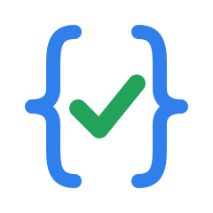
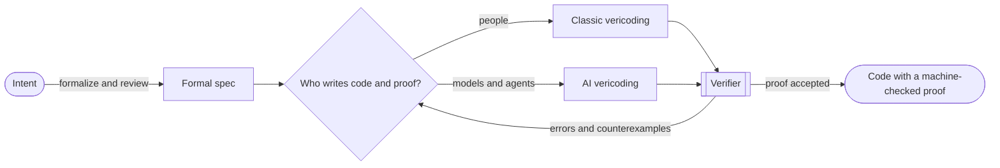

# Awesome Vericoding 

     

> Proof or it didn't ship.

**Vibecoding** asks a model for code and hopes the tests catch the bugs. Sometimes it works, sometimes it doesn't.

**Vericoding** asks for code and a *proof* that it meets a specification, then hands both to a verifier that doesn't care who wrote them or how confident they sound. If the proof checks, the code does what the specification says, which leaves you two things to worry about: whether the specification says what you meant and whether the verifier can be trusted.

Bursuc *et al.* (2025) coined the term for LLM-generated, formally verified code, but people were doing the same thing by hand long before the models showed up. This awesome repo covers both: AI vericoding, and its artisanal ancestor, classic vericoding, where people still write the proofs themselves.

|                                | Classic vericoding                        | AI vericoding                                  |
| ------------------------------ | ----------------------------------------- | ---------------------------------------------- |
| **Who writes the spec**        | People                                    | People, often starting from AI drafts          |
| **Who writes code and proofs** | People, helped by SMT solvers and tactics | Models and agents, guided by verifier feedback |
| **Who checks the proofs**      | A verifier or proof assistant             | The same verifier or proof assistant           |
| **Main bottleneck**            | Expert time                               | Specification quality and model capability     |

**Naming convention:** "Classic" vericoding is a retronym for what the field calls verified programming, auto-active verification, or proof-oriented programming. "AI vericoding" says *AI* rather than *LLM* on purpose: the lineage runs from pre-LLM neural provers such as Code2Inv and Proverbot9001 to today's RL-trained provers and verifier-in-the-loop agents. Some authors split it further into inductive vericoding (sample, check, retry) and [deductive vericoding](https://github.com/Beneficial-AI-Foundation/deductive-vericoding) (refine the spec into smaller specs, solve those, and compose the results).

**Legend:** ⭐ good place to start · 🏭 used in production · 💰 paid

## Contents

- [🚀 Start Here](#-start-here)
- [📐 Classic Vericoding](#-classic-vericoding)
  - [📜 Foundations](#-foundations)
  - [📝 Essays](#-essays)
  - [🧩 Verification-Aware Languages](#-verification-aware-languages)
  - [🔧 Verifiers for Mainstream Languages](#-verifiers-for-mainstream-languages)
  - [🧮 Proof Assistants](#-proof-assistants)
  - [🧱 Verification Infrastructure](#-verification-infrastructure)
  - [🏰 Verified Systems](#-verified-systems)
  - [📰 Industry Reports](#-industry-reports)
  - [📚 Books](#-books)
  - [🎓 Courses and Tutorials](#-courses-and-tutorials)
  - [📘 Official Cheat Sheets](#-official-cheat-sheets)
  - [✏️ Unofficial Cheat Sheets](#-unofficial-cheat-sheets)
- [🤖 AI Vericoding](#-ai-vericoding)
  - [💬 Position Papers and Essays](#-position-papers-and-essays)
  - [📖 Surveys](#-surveys)
  - [📊 Benchmarks](#-benchmarks)
  - [✨ Verified Code Generation](#-verified-code-generation)
  - [🧠 Proof and Annotation Synthesis](#-proof-and-annotation-synthesis)
  - [📋 Specification Generation](#-specification-generation)
  - [🔄 Verified Translation](#-verified-translation)
  - [🧪 Field Reports](#-field-reports)
  - [🏆 Theorem-Proving Models](#-theorem-proving-models)
  - [🔌 Agent Tooling](#-agent-tooling)
  - [🏢 Organizations](#-organizations)
- [🔍 Trust Checklist](#-trust-checklist)
- [📅 Milestones](#-milestones)
- [🌍 Community](#-community)
  - [🥇 Competitions](#-competitions)
  - [🎤 Venues](#-venues)
  - [💭 Forums](#-forums)
  - [📣 Blogs](#-blogs)
- [🔗 Meta](#-meta)

## 🚀 Start Here

> *Start here with zero assumptions*

1. [Extra, Extra - Read All About It: Nearly All Binary Searches and Mergesorts are Broken](https://research.google/blog/extra-extra-read-all-about-it-nearly-all-binary-searches-and-mergesorts-are-broken/) - A now-classic blog post from Google's former Chief Java Architect about a bug that fooled everyone.
2. [When AI Writes the World's Software, Who Verifies It?](https://leodemoura.github.io/blog/2026-2-28-when-ai-writes-the-worlds-software-who-verifies-it/) - Leonardo de Moura, creator of Lean, on why machine-checked proofs not more code review are the answer to AI-written software.

To write your first verified code by hand:

1. [Dafny Tutorial](https://dafny.org/latest/OnlineTutorial/guide) - Write and verify small programs with preconditions, postconditions, and loop invariants.
2. [Natural Number Game](https://adam.math.hhu.de/#/g/leanprover-community/nng4) - Learn interactive proof in Lean by playing levels in the browser, no installation needed.
3. [Let's Prove Leftpad](https://github.com/hwayne/lets-prove-leftpad) - One small function proved in two dozen tools, so you can compare styles before choosing one.

To try AI vericoding:

1. [Prediction: AI Will Make Formal Verification Go Mainstream](https://martin.kleppmann.com/2025/12/08/ai-formal-verification.html) - A short, accessible case for why AI makes formal verification practical.
2. Ask your coding assistant for a small Dafny method with its preconditions and postconditions, run `dafny verify`, and check the result against the Trust Checklist before believing it.

## 📐 Classic Vericoding

> *People write the proofs and machines check every step*

### 📜 Foundations

> *Every verifier on this page runs on these ideas*

- [Assigning Meanings to Programs](https://doi.org/10.1007/978-94-011-1793-7_4) - Floyd attaches logical assertions to flowcharts, the origin of inductive assertions and loop invariants. *Symposia in Applied Mathematics 1967*
- [An Axiomatic Basis for Computer Programming](https://doi.org/10.1145/363235.363259) - Hoare introduces pre/postcondition triples and axiomatic proof rules for programs. *CACM 1969*
- [Guarded Commands, Nondeterminacy and Formal Derivation of Programs](https://doi.org/10.1145/360933.360975) - Dijkstra's weakest-precondition calculus for deriving a program and its proof together. *CACM 1975*
- [Applying 'Design by Contract'](https://doi.org/10.1109/2.161279) - Meyer makes preconditions, postconditions, and invariants part of everyday object-oriented design. *IEEE Computer 1992*
- [Separation Logic: A Logic for Shared Mutable Data Structures](https://doi.org/10.1109/LICS.2002.1029817) - Reynolds's logic for local reasoning about heaps and pointers, the basis of VeriFast, Viper, and Iris. *LICS 2002*
- [The Verifying Compiler: A Grand Challenge for Computing Research](https://doi.org/10.1145/602382.602403) - Hoare's call for tools that check every program against its specification, an early statement of the vericoding goal. *JACM 2003*
- [QED at Large: A Survey of Engineering of Formally Verified Software](https://doi.org/10.1561/2500000045) - How large verified systems are designed, maintained, and repaired in practice. *Foundations and Trends in PL 2019*

### 📝 Essays

> *50+ years of arguing about whether proving programs is worth the trouble*

- [The Humble Programmer](https://www.cs.utexas.edu/~EWD/transcriptions/EWD03xx/EWD340.html) - Dijkstra's Turing lecture, where testing "is hopelessly inadequate for showing their absence" of bugs. *Turing Award Lecture 1972*
- [Social Processes and Proofs of Theorems and Programs](https://doi.org/10.1145/359104.359106) - The classic critique of program verification: mathematical proofs earn trust through social processes that program proofs lack. *CACM 1979*
- [How Did Software Get So Reliable Without Proof?](https://doi.org/10.1007/3-540-60973-3_77) - Hoare asks why software works as well as it does without the verification he championed. *FME 1996*
- [Who Builds a House Without Drawing Blueprints?](https://doi.org/10.1145/2736348) - Lamport's case for writing a specification before writing code. *CACM 2015*
- [OpenJDK's Java.utils.Collection.sort() Is Broken: The Good, the Bad and the Worst Case](https://doi.org/10.1007/978-3-319-21690-4_16) - Verifying TimSort with KeY exposed a bug in the sort used by Java, Android, and Python, and proved a fix. *CAV 2015*
- [Why Don't People Use Formal Methods?](https://www.hillelwayne.com/post/why-dont-people-use-formal-methods/) - Hillel Wayne's map of what formal verification costs and where it pays off. *Blog 2019*
- [Formal Methods Only Solve Half My Problems](https://brooker.co.za/blog/2022/06/02/formal.html) - Marc Brooker on what proofs leave out: latency, cost, and behavior under overload. *Blog 2022*

### 🧩 Verification-Aware Languages

> *The verifier complains the moment your code and spec disagree*

- [Dafny](https://dafny.org) ⭐ 🏭 - Imperative and functional language with built-in contracts, verified through Boogie and Z3 and compiled to several mainstream languages ([LPAR 2010 paper](https://doi.org/10.1007/978-3-642-17511-4_20)).
- [F*](https://fstar-lang.org) 🏭 - Proof-oriented functional language with dependent types and SMT automation; its Low* subset compiles to C through KaRaMeL ([POPL 2016 paper](https://doi.org/10.1145/2837614.2837655)).
- [SPARK](https://github.com/AdaCore/spark2014) 🏭 - Formally analyzable subset of Ada whose GNATprove tool proves absence of runtime errors and functional contracts.
- [Velvet](https://velvetprover.dev) - Dafny-style auto-active verifier embedded in Lean that mixes SMT automation with interactive and AI-assisted proofs ([introduction](https://proofsandintuitions.net/2026/01/21/multi-modal-verification-velvet/)).
- [Why3](https://why3.org) - Platform for deductive verification of WhyML programs that sends proof obligations to many SMT solvers and proof assistants ([ESOP 2013 paper](https://doi.org/10.1007/978-3-642-37036-6_8)).

### 🔧 Verifiers for Mainstream Languages

> *Keep the language you ship and add the proofs*

- C
  - [CBMC](https://github.com/diffblue/cbmc) 🏭 - Bounded model checker for C and C++ that checks memory safety and user assertions up to a loop bound.
  - [CN](https://github.com/rems-project/cn) - Separation-logic refinement type system for verifying systems C code.
  - [ESBMC](https://github.com/esbmc/esbmc) - SMT-based bounded model checker for C and C++, with front ends for further languages.
  - [Frama-C](https://frama-c.com) 🏭 - Platform for analyzing C code whose WP plugin proves ACSL function contracts deductively.
  - [VeriFast](https://github.com/verifast/verifast) - Separation-logic verifier for C, Rust, and Java built on fast symbolic execution ([NFM 2011 paper](https://doi.org/10.1007/978-3-642-20398-5_4)).
  - [VST](https://vst.cs.princeton.edu) - Verified Software Toolchain, a program logic for C in Rocq proved sound against CompCert's semantics ([ESOP 2011 paper](https://doi.org/10.1007/978-3-642-19718-5_1)).
- Go
  - [Gobra](https://www.pm.inf.ethz.ch/research/gobra.html) - Modular verifier for Go programs built on Viper.
  - [Perennial](https://github.com/mit-pdos/perennial) - Rocq and Iris framework for verifying concurrent, crash-safe storage and distributed systems written in Go.
- Haskell
  - [Liquid Haskell](https://ucsd-progsys.github.io/liquidhaskell/) - Refinement types for Haskell, checked by an SMT solver ([ICFP 2014 paper](https://doi.org/10.1145/2628136.2628161)).
- Java
  - [KeY](https://www.key-project.org) - Deductive verifier for Java programs annotated with JML.
  - [OpenJML](https://www.openjml.org) - Verification and runtime checking for Java programs specified in JML.
  - [VerCors](https://vercors.ewi.utwente.nl) - Verifier for concurrent and GPU programs written in Java, C, and OpenCL.
- OCaml
  - [Cameleer](https://github.com/ocaml-gospel/cameleer) - Deductive verifier for OCaml programs specified in the Gospel language, built on Why3.
- Python
  - [Nagini](https://github.com/marcoeilers/nagini) - Static verifier for Python 3 built on Viper.
- Rust
  - [Aeneas](https://aeneasverif.github.io) - Translates safe Rust into pure functional code for proofs in Lean, Rocq, F*, or HOL4 ([ICFP 2022 paper](https://doi.org/10.1145/3547647)).
  - [Creusot](https://creusot.rs) - Deductive verifier that turns annotated Rust into Why3 proof obligations ([ICFEM 2022 paper](https://doi.org/10.1007/978-3-031-17244-1_6)).
  - [Flux](https://flux-rs.github.io/flux/) - Refinement types for Rust.
  - [hax](https://hax.cryspen.com) - Extracts Rust to F*, Rocq, and other proof back ends, used for verified cryptography.
  - [Kani](https://model-checking.github.io/kani) 🏭 - Bit-precise model checker for Rust built on CBMC, often used to verify unsafe code.
  - [Prusti](https://prusti.github.io/prusti/) - Viper-based verifier that uses Rust's ownership types to keep specifications simple ([OOPSLA 2019 paper](https://doi.org/10.1145/3360573)).
  - [Verus](https://github.com/verus-lang/verus) ⭐ - SMT-based verifier for Rust, including low-level systems code, built on linear ghost types ([OOPSLA 2023 paper](https://doi.org/10.1145/3586037), [SOSP 2024 paper](https://doi.org/10.1145/3694715.3695952)).
- Scala
  - [Stainless](https://epfl-lara.github.io/stainless/) - Verification framework for a functional subset of Scala.

### 🧮 Proof Assistants

> *You and the prover close one goal at a time*

- [ACL2](https://www.cs.utexas.edu/~moore/acl2/) 🏭 - Applicative Common Lisp with an automated theorem prover, long used to verify industrial hardware and software.
- [Agda](https://github.com/agda/agda) - Dependently typed programming language and proof assistant.
- [HOL4](https://hol-theorem-prover.org) - Higher-order logic theorem prover behind the CakeML verified compiler.
- [Idris 2](https://www.idris-lang.org) - Purely functional language with first-class dependent types for type-driven development.
- [Isabelle](https://isabelle.in.tum.de) ⭐ - Generic proof assistant, best known for Isabelle/HOL and its Sledgehammer automation, used to verify the seL4 kernel.
- [Lean 4](https://lean-lang.org) ⭐ 🏭 - Functional programming language and proof assistant whose `mvcgen` tactic turns imperative-style code into verification conditions ([CADE 2021 paper](https://doi.org/10.1007/978-3-030-79876-5_37), [mvcgen reference](https://lean-lang.org/doc/reference/latest/The--mvcgen--tactic/)).
- [PVS](https://pvs.csl.sri.com) - Specification language and theorem prover from SRI, used extensively at NASA.
- [Rocq](https://rocq-prover.org) ⭐ - Proof assistant formerly known as Coq, behind CompCert, Fiat Cryptography, and the Verified Software Toolchain.

### 🧱 Verification Infrastructure

> *The solvers and checkers that run every time you hit save*

- [Alt-Ergo](https://alt-ergo.ocamlpro.com) - SMT solver tuned for proof obligations from program verifiers such as Why3 and Frama-C.
- [Bitwuzla](https://bitwuzla.github.io) - SMT solver for bit-vectors, floating point, arrays, and uninterpreted functions.
- [Boogie](https://github.com/boogie-org/boogie) - Intermediate verification language and verifier that Dafny and other front ends compile to.
- [CoqHammer](https://github.com/lukaszcz/coqhammer) - Hammer for Rocq that combines premise selection, external provers, and proof reconstruction.
- [cvc5](https://cvc5.github.io) - Open-source SMT solver with broad theory support and proof production ([TACAS 2022 paper](https://doi.org/10.1007/978-3-030-99524-9_24)).
- [Iris](https://iris-project.org) - Higher-order concurrent separation logic framework in Rocq ([JFP 2018 paper](https://doi.org/10.1017/S0956796818000151)).
- [lean4lean](https://github.com/digama0/lean4lean) - Independent Lean 4 kernel written in Lean, for rechecking proofs outside the main implementation.
- [LeanHammer](https://github.com/JOSHCLUNE/LeanHammer) - Hammer for Lean that pairs learned premise selection with automated provers ([premise selection paper](https://arxiv.org/abs/2506.07477)).
- [nanoda](https://github.com/ammkrn/nanoda_lib) - Independent Lean 4 type checker in Rust, a second opinion on any Lean proof.
- [Viper](https://www.pm.inf.ethz.ch/research/viper.html) - Permission-based verification infrastructure behind Prusti, Nagini, and Gobra ([VMCAI 2016 paper](https://doi.org/10.1007/978-3-662-49122-5_2)).
- [Z3](https://github.com/Z3Prover/z3) ⭐ 🏭 - SMT solver from Microsoft Research that underpins Dafny, Verus, F*, and much of industrial verification ([TACAS 2008 paper](https://doi.org/10.1007/978-3-540-78800-3_24)).

### 🏰 Verified Systems

> *Existence proofs for verified software at scale*

- [CompCert](https://compcert.org) 🏭 - Optimizing C compiler verified in Rocq to preserve the semantics of the source program ([CACM 2009 paper](https://doi.org/10.1145/1538788.1538814)).
- [seL4](https://sel4.systems) ⭐ 🏭 - Microkernel with machine-checked proofs of functional correctness and security properties in Isabelle/HOL ([SOSP 2009 paper](https://doi.org/10.1145/1629575.1629596), [what the proofs assume](https://sel4.systems/Verification/proofs.html)).
- [CakeML](https://cakeml.org) - Verified implementation of a dialect of ML, including a verified compiler, in HOL4 ([POPL 2014 paper](https://doi.org/10.1145/2535838.2535841)).
- [IronFleet: Proving Practical Distributed Systems Correct](https://doi.org/10.1145/2815400.2815428) - Dafny proofs of safety and liveness for a Paxos-based replicated state machine and a sharded key-value store. *SOSP 2015*
- [Using Crash Hoare Logic for Certifying the FSCQ File System](https://doi.org/10.1145/2815400.2815402) - FSCQ, a file system proved in Rocq to recover correctly from crashes. *SOSP 2015*
- [Verdi](https://github.com/uwplse/verdi) - Rocq framework for implementing and verifying distributed systems, including the Raft consensus protocol.
- [CertiKOS](https://flint.cs.yale.edu/certikos/) - Architecture for building certified concurrent operating system kernels in Rocq.
- [HACL*](https://hacl-star.github.io) 🏭 - Verified cryptographic library written in F* and compiled to C, deployed in Mozilla Firefox and the Linux kernel ([CCS 2017 paper](https://doi.org/10.1145/3133956.3134043)).
- [Project Everest](https://project-everest.github.io) - Verified components for the HTTPS ecosystem, including HACL*, EverCrypt, and the EverParse parser generator.
- [Fiat Cryptography](https://github.com/mit-plv/fiat-crypto) 🏭 - Generates verified elliptic-curve field arithmetic from Rocq specifications; its code ships in BoringSSL ([S&P 2019 paper](https://doi.org/10.1109/SP.2019.00005)).
- [s2n-bignum](https://github.com/awslabs/s2n-bignum) - Bignum and cryptographic assembly for x86-64 and Arm from AWS, proved correct in HOL Light.
- [Anvil](https://github.com/anvil-verifier/anvil) - Framework for Kubernetes controllers with Verus proofs of liveness ([OSDI 2024 paper](https://www.usenix.org/conference/osdi24/presentation/sun-xudong)).
- [Cedar](https://www.cedarpolicy.com) 🏭 - Authorization policy language whose semantics and key properties are proved in Lean and checked against the production Rust code by differential testing.
- [SampCert](https://github.com/leanprover/SampCert) - Verified differential-privacy samplers and mechanisms in Lean, developed at AWS.
- [VeriSMo](https://github.com/microsoft/verismo) - Security module for AMD SEV-SNP confidential VMs, written in Rust and verified with Verus ([OSDI 2024 paper](https://www.usenix.org/conference/osdi24/presentation/zhou)).
- [Atmosphere: Practical Verified Kernels with Rust and Verus](https://doi.org/10.1145/3731569.3764821) - Microkernel written in Rust with Verus proofs, built for practical use. *SOSP 2025*

### 📰 Industry Reports

> *What happened when big companies put proofs into production*

- [How Amazon Web Services Uses Formal Methods](https://doi.org/10.1145/2699417) - TLA+ specifications caught subtle design bugs in DynamoDB, S3, and other core AWS services. *CACM 2015*
- [Verified Cryptography for Firefox 57](https://blog.mozilla.org/security/2017/09/13/verified-cryptography-firefox-57/) - Mozilla on shipping HACL* Curve25519 in NSS, the first formally verified cryptography in a major browser. *Mozilla Security Blog 2017*
- [Formally Verified Software in the Real World](https://doi.org/10.1145/3230627) - How seL4 and verified components hardened military vehicles against cyber attacks in DARPA's HACMS program. *CACM 2018*
- [How We Built Cedar: A Verification-Guided Approach](https://doi.org/10.1145/3663529.3663854) - AWS pairs Lean proofs with differential random testing to keep an authorization engine correct. *FSE 2024 Industry*
- [Rewriting SymCrypt in Rust to Modernize Microsoft's Cryptographic Library](https://www.microsoft.com/en-us/research/blog/rewriting-symcrypt-in-rust-to-modernize-microsofts-cryptographic-library/) - Microsoft rewrites its core crypto library in Rust and proves it correct with Aeneas and Lean. *Microsoft Research Blog 2025*
- [Systems Correctness Practices at Amazon Web Services](https://doi.org/10.1145/3729175) - How AWS combines specification, model checking, proof, and testing across its services. *CACM 2025*

### 📚 Books

> *For when the tutorial ends and the proofs get long*

- [Building High Integrity Applications with SPARK](https://www.cambridge.org/core/books/building-high-integrity-applications-with-spark/F213D9867D2E271F5FF3EDA765D48E95) 💰 - McCormick and Chapin's introduction to SPARK and its proof tools.
- [Certified Programming with Dependent Types](https://adam.chlipala.net/cpdt/) - Chlipala on engineering large verified programs in Rocq with heavy proof automation.
- [Concrete Semantics](http://concrete-semantics.org) - Nipkow and Klein's free book on semantics, Hoare logic, and program analysis in Isabelle/HOL.
- [Deductive Software Verification: The KeY Book](https://link.springer.com/book/10.1007/978-3-319-49812-6) - Comprehensive guide to specifying Java with JML and verifying it with KeY.
- [Formal Reasoning About Programs](https://adam.chlipala.net/frap/) - Chlipala's MIT course book on semantics, program logics, and verification in Rocq.
- [Functional Programming in Lean](https://lean-lang.org/functional_programming_in_lean/) - Christiansen's introduction to Lean 4 as a programming language.
- [Program Proofs](https://program-proofs.com) ⭐ 💰 - Leino's hands-on textbook on writing verified programs in Dafny.
- [Programming Language Foundations in Agda](https://plfa.github.io) - Programming language theory developed with machine-checked proofs in Agda.
- [Proof-Oriented Programming in F*](https://fstar-lang.org/tutorial/) - The official book on writing programs and proofs together in F*.
- [Software Foundations](https://softwarefoundations.cis.upenn.edu) ⭐ - Free Rocq series from logic basics to verified functional algorithms, separation logic, and Verifiable C.
- [The Calculus of Computation](https://link.springer.com/book/10.1007/978-3-540-74113-8) 💰 - Bradley and Manna on decision procedures and the logic behind program verifiers.
- [Theorem Proving in Lean 4](https://lean-lang.org/theorem_proving_in_lean4/) - Introduction to dependent type theory and interactive proof in Lean 4.
- [Type-Driven Development with Idris](https://www.manning.com/books/type-driven-development-with-idris) 💰 - Brady on using dependent types to make programs correct by construction.

### 🎓 Courses and Tutorials

> *Homework graded by a verifier that never gives partial credit*

- [CMU 15-414: Bug Catching](https://www.cs.cmu.edu/~15414/) - Carnegie Mellon course on automated program verification with Why3, decision procedures, and model checkers.
- [DeepSpec Summer School 2018](https://deepspec.org/event/dsss18/) - Recorded lectures on building end-to-end verified systems in Rocq.
- [Frama-C WP Tutorial](https://allan-blanchard.fr/frama-c-wp-tutorial.html) - Step-by-step guide to proving C programs with Frama-C's WP plugin.
- [Intro to SPARK](https://learn.adacore.com/courses/intro-to-spark/index.html) - Interactive AdaCore course on proving Ada code with SPARK.
- [Kani Tutorial](https://model-checking.github.io/kani/kani-tutorial.html) - First steps in model-checking Rust code with Kani.
- [Learn Lean](https://lean-lang.org/learn/) - Official hub of Lean books, courses, and interactive games.
- [Oregon Programming Languages Summer School](https://www.cs.uoregon.edu/research/summerschool/) - Annual summer school whose recorded lectures often cover proof assistants and program logics.
- [Verification Corner](https://www.youtube.com/channel/UCP2eLEql4tROYmIYm5mA27A) - Rustan Leino's video series on specifications, invariants, and Dafny.
- [Verus Guide](https://verus-lang.github.io/verus/guide/) ⭐ - Official tutorial and reference for verifying Rust with Verus.

### 📘 Official Cheat Sheets

> *Language tours already published on Learn X in Y Minutes*

- [Learn Agda in Y Minutes](https://learnxinyminutes.com/agda/) - Dependent types and proofs written as total programs.
- [Learn Coq in Y Minutes](https://learnxinyminutes.com/coq/) - A programming introduction to Gallina for the prover now called Rocq.
- [Learn Lean 4 in Y Minutes](https://learnxinyminutes.com/lean4/) - Dependent types, propositions, and tactic proofs.

### ✏️ Unofficial Cheat Sheets

> *One page of syntax before your first proof obligation*

- [Learn ACL2 in Y Minutes](primers/acl2.md) - A terminating definition and the theorems the waterfall is expected to prove alone.
- [Learn ACSL in Y Minutes](primers/acsl.md) - Function contracts, frames, and a loop variant for Frama-C's WP plugin.
- [Learn Agda in Y Minutes](primers/agda.md) - A proof of associativity and a lookup whose index is a type.
- [Learn Boogie in Y Minutes](primers/boogie.md) - Uninterpreted functions, axioms, and a loop whose frame is an invariant.
- [Learn CN in Y Minutes](primers/cn.md) - Ownership, returned on exit, for a pointer and for every cell of an array.
- [Learn Creusot in Y Minutes](primers/creusot.md) - Pearlite logic functions and the view of a Rust value in that logic.
- [Learn Dafny in Y Minutes](primers/dafny.md) - Ghost lemmas, a frame, and a binary search whose invariant is the postcondition.
- [Learn F* in Y Minutes](primers/fstar.md) - Refinements as preconditions and an SMT lemma whose body is the induction.
- [Learn Flux in Y Minutes](primers/flux.md) - Predicates attached to Rust types, including the overflow check beside them.
- [Learn Gobra in Y Minutes](primers/gobra.md) - Go comments for contracts, termination, and permission to each slice cell.
- [Learn Gospel in Y Minutes](primers/gospel.md) - OCaml contracts in comments, including a checks clause a test can monitor.
- [Learn HOL4 in Y Minutes](primers/hol4.md) - A Holmake script: a definition used by name, then an induction.
- [Learn Idris 2 in Y Minutes](primers/idris.md) - Totality checking, and a vector whose length is part of its type.
- [Learn Isabelle in Y Minutes](primers/isabelle.md) - Simplification when it is enough, and an induction when auto will not invent one.
- [Learn JML in Y Minutes](primers/jml.md) - Java comments whose arithmetic is mathematical, with a bound so the code stays in range.
- [Learn Kani in Y Minutes](primers/kani.md) - A bounded harness, and a contract the harness does not restate.
- [Learn Lean 4 in Y Minutes](primers/lean.md) - Tactic proofs, a dependent index, and a loop whose conditions come from mvcgen.
- [Learn Liquid Haskell in Y Minutes](primers/liquid-haskell.md) - Refinement types and a measure the solver uses without an induction.
- [Learn Nagini in Y Minutes](primers/nagini.md) - Python calls that are contracts, including the variant of a loop.
- [Learn Prusti in Y Minutes](primers/prusti.md) - Rust attributes for contracts, with ownership left to the borrow checker.
- [Learn PVS in Y Minutes](primers/pvs.md) - A recursive definition whose typechecker emits the termination condition.
- [Learn Rocq in Y Minutes](primers/rocq.md) - A Gallina program and the tactic proof that append distributes over sum.
- [Learn SPARK in Y Minutes](primers/spark.md) - An expression function and a loop that must also be free of overflow.
- [Learn Stainless in Y Minutes](primers/stainless.md) - Scala contracts on BigInt, so overflow is not the verification condition.
- [Learn Velvet in Y Minutes](primers/velvet.md) - Dafny-style methods whose verification conditions are Lean goals.
- [Learn Verus in Y Minutes](primers/verus.md) - The split between spec, proof, and exec, plus a loop variant.
- [Learn Viper in Y Minutes](primers/viper.md) - Permissions that must be held, split, and given back.
- [Learn WhyML in Y Minutes](primers/whyml.md) - A logical function, a variant, and the obligations Alt-Ergo receives.

## 🤖 AI Vericoding

> *The model writes the proof and you still own the spec*

### 💬 Position Papers and Essays

> *The case for putting a verifier between AI and production*

- [Provably Safe Systems: The Only Path to Controllable AGI](https://arxiv.org/abs/2309.01933) - Tegmark and Omohundro argue for constraining powerful AI with machine-checked proofs, with AI writing the verified code. *arXiv 2023*
- [Towards Guaranteed Safe AI: A Framework for Ensuring Robust and Reliable AI Systems](https://arxiv.org/abs/2405.06624) - Framework pairing a world model, a safety specification, and a verifier that checks AI behavior against them. *arXiv 2024*
- [Formal Mathematical Reasoning: A New Frontier in AI](https://arxiv.org/abs/2412.16075) - Position paper on AI that reasons inside formal systems, with verified code generation as a key application. *arXiv 2024*
- [Dafny as Verification-Aware Intermediate Language for Code Generation](https://arxiv.org/abs/2501.06283) - Proposes having LLMs write verified Dafny from user intent and then compiling it to the target language. *arXiv 2025*
- [Lean Software Scaling Laws](https://gwern.net/lean-scaling) - Gwern argues that Lean may scale better with codebase size than mainstream languages, making large verified programs easier for LLMs to write. *Essay 2025*
- [Position: Vibe Coding Needs Vibe Reasoning: Improving Vibe Coding with Formal Verification](https://arxiv.org/abs/2511.00202) - Argues for adding formal verification to the vibe-coding loop. *LMPL 2025*
- [On the Success of 'Natural Language Programming'](https://brooker.co.za/blog/2025/12/16/natural-language.html) - Marc Brooker argues that specification is becoming the core of programming, with formal tools taking over where precision matters. *Blog 2025*
- [Who Watches the Provers?](https://leodemoura.github.io/blog/2026-3-16-who-watches-the-provers/) - Leonardo de Moura on why small, independently implemented proof kernels make AI-generated proofs trustworthy. *Blog 2026*
- [When the Hard Part Stops Being Hard](https://proofsandintuitions.net/2026/08/14/when-the-hard-part-stops-being-hard/) - Ilya Sergey on mechanizing a production type system's metatheory with AI in about four weeks, and what that means for research. *Blog 2026*
- [Skills for the future software profession: beyond agentic AI!](https://www.youtube.com/watch?v=UMTHkr9cnig) - Argues that verification and validation is increasing in importance as agents handle implementation, and that future software professionals will need to be proficient in these areas. *arXiv 2026*

### 📖 Surveys

> *The map before the territory*

- [A Survey on Deep Learning for Theorem Proving](https://arxiv.org/abs/2404.09939) - Taxonomy of neural theorem proving, autoformalization, and their datasets. *COLM 2024* · [Paper list](https://github.com/zhaoyu-li/DL4TP)
- [The Fusion of Large Language Models and Formal Methods for Trustworthy AI Agents: A Roadmap](https://arxiv.org/abs/2412.06512) - Roadmap for combining LLMs and formal methods in both directions. *arXiv 2024*
- [Challenges and Paths Towards AI for Software Engineering](https://arxiv.org/abs/2503.22625) - Survey of open problems in AI for software engineering, including verified code generation. *arXiv 2025*

### 📊 Benchmarks

> *Check what counts as solved before you quote a number*

| Benchmark                                                                                                | Year | Verifiers            | Size                          | Task                                                 |
| -------------------------------------------------------------------------------------------------------- | ---- | -------------------- | ----------------------------- | ---------------------------------------------------- |
| [CoqGym](https://arxiv.org/abs/1905.09381)                                                               | 2019 | Rocq                 | 71K proofs from 123 projects  | Proof synthesis                                      |
| [DafnyBench](https://arxiv.org/abs/2406.08467)                                                           | 2024 | Dafny                | 750+ programs                 | Annotation (hint) generation                         |
| [FStarDataSet](https://huggingface.co/datasets/microsoft/FStarDataSet)                                   | 2024 | F*                   | 32K definitions               | Proof-oriented program synthesis                     |
| [MBPP-DFY](https://github.com/Mondego/dafny-synthesis)                                                   | 2024 | Dafny                | 153 verified solutions        | Natural language to verified method                  |
| [miniCodeProps](https://arxiv.org/abs/2406.11915)                                                        | 2024 | Lean                 | 201 specifications            | Proving program properties                           |
| [Verus-Bench](https://github.com/microsoft/verus-proof-synthesis)                                        | 2024 | Verus                | 150 tasks                     | Proof generation                                     |
| [CLEVER](https://arxiv.org/abs/2505.13938)                                                               | 2025 | Lean                 | 161 problems                  | Specification, code, and proof                       |
| [FVAPPS](https://arxiv.org/abs/2502.05714)                                                               | 2025 | Lean                 | 4,715 problems                | Code and proof from a specification                  |
| [Vericoding](https://arxiv.org/abs/2509.22908)                                                           | 2025 | Dafny, Verus, Lean   | 12,504 specifications         | Code and proof from a specification                  |
| [VERINA](https://arxiv.org/abs/2505.23135)                                                               | 2025 | Lean                 | 189 tasks                     | Code, specification, and proof                       |
| [VerifyThisBench](https://arxiv.org/abs/2505.19271)                                                      | 2025 | Several              | VerifyThis challenges         | Specification, code, and proof from natural language |
| [VeruSAGE-Bench](https://github.com/microsoft/verus-proof-synthesis/tree/main/benchmarks/VeruSAGE-Bench) | 2025 | Verus                | 849 tasks from eight systems  | Systems proof tasks                                  |
| [AlgoVeri](https://arxiv.org/abs/2602.09464)                                                             | 2026 | Dafny, Verus, Lean   | 77 algorithms                 | Aligned cross-language vericoding                    |
| [LCB-Pro-Dafny](https://arxiv.org/pdf/2606.32007)                                                        | 2026 | Dafny                | 250 problems                  | Competitive programming                              |
| [NTP4VC](https://arxiv.org/abs/2601.18944)                                                               | 2026 | Isabelle, Lean, Rocq | Linux and Contiki proof goals | Proving verification conditions                      |
| [VeriContest](https://arxiv.org/abs/2605.08553)                                                          | 2026 | Verus                | 946 problems                  | Code, specification, and proof                       |
| [Verus-SpecBench](https://arxiv.org/abs/2605.26457)                                                      | 2026 | Verus                | 581 tasks                     | Specification autoformalization                      |
| [Vero](https://arxiv.org/abs/2608.13522)                                                                 | 2026 | Lean                 | 43 repositories               | Repository-level code and proof                      |

### ✨ Verified Code Generation

> *Ask for code and get a receipt from the verifier*

- [Clover: Closed-Loop Verifiable Code Generation](https://arxiv.org/abs/2310.17807) - Generates Dafny code, docstrings, and specifications, accepting them only when all three are mutually consistent. *SAIV 2024* · [Code](https://github.com/ChuyueSun/Clover)
- [Towards AI-Assisted Synthesis of Verified Dafny Methods](https://arxiv.org/abs/2402.00247) - GPT-4 writes verified Dafny for MBPP problems, released as the MBPP-DFY dataset. *FSE 2024*
- [VerMCTS: Synthesizing Multi-Step Programs using a Verifier, a Large Language Model, and Tree Search](https://arxiv.org/abs/2402.08147) - Monte Carlo tree search in which the verifier scores partial Dafny and Rocq programs. *arXiv 2024* · [Code](https://github.com/namin/llm-verified-with-monte-carlo-tree-search)
- [Towards Automated Verification of LLM-Synthesized C Programs](https://arxiv.org/abs/2410.14835) - SynVer biases LLM-generated C toward code that the Verified Software Toolchain can prove automatically. *arXiv 2024*
- [VeCoGen: Automating Generation of Formally Verified C Code with Large Language Models](https://arxiv.org/abs/2411.19275) - Iterates on C code against ACSL specifications until Frama-C proves it correct. *FormaliSE 2025* · [Code](https://github.com/ASSERT-KTH/Vecogen)
- [AlphaVerus: Bootstrapping Formally Verified Code Generation through Self-Improving Translation and Treefinement](https://arxiv.org/abs/2412.06176) - Bootstraps verified Rust by translating Dafny programs into Verus and refining failures with tree search. *ICML 2025* · [Code](https://github.com/cmu-l3/alphaverus)
- [Re:Form: Reducing Human Annotations in Scalable Formal Software Verification with RL in LLMs](https://arxiv.org/abs/2507.16331) - Reinforcement learning with the Dafny verifier as reward teaches small models to write verifiable code. *TMLR 2026*
- [ATLAS: Automated Toolkit for Large-Scale Verified Code Synthesis](https://arxiv.org/abs/2512.10173) - Turns Python solutions into 2.7K verified Dafny programs for fine-tuning, lifting a 7B model on DafnyBench from 32% to 57%. *arXiv 2025*
- [Propose, Solve, Verify: Self-Play Through Formal Verification](https://arxiv.org/abs/2512.18160) - Self-play in which a model proposes Verus problems and trains on verifier-checked solutions. *arXiv 2025*
- [WybeCoder: Verified Imperative Code Generation](https://arxiv.org/abs/2603.29088) - Prove-as-you-generate agent for imperative code in Lean that solves 74% of VERINA and 62% of CLEVER. *arXiv 2026* · [Code](https://github.com/facebookresearch/wybecoder)
- [Certified Program Synthesis with a Multi-Modal Verifier](https://arxiv.org/abs/2604.16584) - Combines auto-active and interactive proof in one verifier and flags specifications that are too weak or too strong. *ASE 2026*
- [AxDafny: Agentic Verified Code Generation in Dafny](https://arxiv.org/abs/2606.32007) - Verifier-guided repair agent that writes code, invariants, and termination arguments, reaching 92.7% on DafnyBench. *ICML 2026*
- [Formal Disco: Scalable Open-Ended Generation of Formally Verified Programs](https://arxiv.org/abs/2607.04631) - Open-ended discovery loop that produces large datasets of verified programs in Dafny, Verus, and Frama-C. *arXiv 2026* · [Code](https://github.com/metareflection/formal-disco)
- [P³: Joint Program-and-Proof Planning for Verified Code Generation](https://arxiv.org/abs/2608.09277) - Plans the program and its proof together before writing either, raising solve rates on VERINA and AlgoVeri. *arXiv 2026*

### 🧠 Proof and Annotation Synthesis

> *The code is written and the model has to convince the verifier*

- Dafny
  - [Laurel: Unblocking Automated Verification with Large Language Models](https://arxiv.org/abs/2405.16792) - Generates the helper assertions Dafny needs and localizes where they belong. *OOPSLA 2025*
  - [dafny-annotator: AI-Assisted Verification of Dafny Programs](https://arxiv.org/abs/2411.15143) - Fine-tuned open models plus search add the annotations a Dafny method needs to verify. *arXiv 2024* · [Code](https://github.com/metareflection/dafny-annotator)
  - [Can LLMs Enable Verification in Mainstream Programming?](https://arxiv.org/abs/2503.14183) - Compares LLM-written verified code across Dafny, Nagini, and Verus on HumanEval-derived tasks. *arXiv 2025*
  - [DafnyPro: LLM-Assisted Automated Verification for Dafny Programs](https://arxiv.org/abs/2601.05385) - Inference-time framework that raises Claude Sonnet 3.5 to 86% correct proofs on DafnyBench. *arXiv 2026*
- F*
  - [Towards Neural Synthesis for SMT-Assisted Proof-Oriented Programming](https://arxiv.org/abs/2405.01787) - Curates 600K lines of F* and shows fine-tuned small models rival GPT-4 at synthesizing definitions and proofs. *ICSE 2025*
- Isabelle
  - [Baldur: Whole-Proof Generation and Repair with Large Language Models](https://arxiv.org/abs/2303.04910) - Generates whole Isabelle/HOL proofs at once and repairs them from error messages. *ESEC/FSE 2023*
  - [Selene: Pioneering Automated Proof in Software Verification](https://arxiv.org/abs/2401.07663) - Project-level proof benchmark built from the seL4 verification. *ACL 2024*
  - [FVEL: Interactive Formal Verification Environment with Large Language Models via Theorem Proving](https://arxiv.org/abs/2406.14408) - Verifies code through Isabelle and releases FVELER, a dataset of 29K lemmas from seL4. *NeurIPS 2024* · [Project](https://fveler.github.io/)
  - [Neuro-Symbolic Proof Generation for Scaling Systems Software Verification](https://arxiv.org/abs/2603.19715) - Couples LLMs with Sledgehammer through a new Isabelle REPL and proves up to 77.6% of seL4 theorems. *OSDI 2026* · [Code](https://github.com/SoaringE/seL4-proof-search)
- Rocq
  - [Generating Correctness Proofs with Neural Networks](https://arxiv.org/abs/1907.07794) - Proverbot9001, an early neural tactic predictor evaluated on CompCert proofs. *MAPL 2020* · [Code](https://github.com/UCSD-PL/proverbot9001)
  - [Passport: Improving Automated Formal Verification Using Identifiers](https://arxiv.org/abs/2204.10370) - Shows that encoding identifier names boosts neural proof synthesis. *TOPLAS 2023*
  - [Proof Automation with Large Language Models](https://arxiv.org/abs/2409.14274) - PALM pairs LLM-generated proofs with symbolic repair and proves 1,270 theorems beyond earlier tools. *ASE 2024*
  - [Rango: Adaptive Retrieval-Augmented Proving for Automated Software Verification](https://arxiv.org/abs/2412.14063) - Retrieves relevant proofs and lemmas at every step and introduces the CoqStoq dataset of 197K theorems. *ICSE 2025*
  - [QEDCartographer: Automating Formal Verification Using Reward-Free Reinforcement Learning](https://arxiv.org/abs/2408.09237) - Learns a proof-search value function without hand-designed rewards. *ICSE 2025*
  - [Cobblestone: A Divide-and-Conquer Approach for Automating Formal Verification](https://arxiv.org/abs/2410.19940) - Splits Rocq goals and reuses partial LLM progress to prove more theorems cheaply. *ICSE 2026*
- Rust and Verus
  - [Leveraging Large Language Models for Automated Proof Synthesis in Rust](https://arxiv.org/abs/2311.03739) - First study of GPT-4 writing Verus proofs, combined with static analysis and a developer in the loop. *arXiv 2023*
  - [AutoVerus: Automated Proof Generation for Rust Code](https://arxiv.org/abs/2409.13082) - Multi-agent pipeline that generates, refines, and repairs Verus proofs, verifying over 90% of Verus-Bench. *OOPSLA 2025*
  - [Automated Proof Generation for Rust Code via Self-Evolution](https://arxiv.org/abs/2410.15756) - SAFE bootstraps Verus training data through a verifier-checked cycle of synthesis and fine-tuning. *arXiv 2024*
  - [RAG-Verus: Repository-Level Program Verification with LLMs using Retrieval Augmented Generation](https://arxiv.org/abs/2502.05344) - Retrieval-augmented proof synthesis across multi-module Verus repositories. *arXiv 2025*
  - [VeriStruct: AI-assisted Automated Verification of Data-Structure Modules in Verus](https://arxiv.org/abs/2510.25015) - Extends AI verification to whole data-structure modules, verifying 128 of 129 functions. *arXiv 2025*
  - [VeruSAGE: A Study of Agent-Based Verification for Rust Systems](https://arxiv.org/abs/2512.18436) - Agents complete over 80% of 849 proof tasks drawn from eight Verus-verified systems. *arXiv 2025*
  - [ExVerus: Verus Proof Repair via Counterexample Reasoning](https://arxiv.org/abs/2603.25810) - Repairs failing Verus proofs by generalizing concrete counterexamples into invariants. *arXiv 2026*
  - [KVerus: Scalable and Resilient Formal Verification Proof Generation for Rust Code](https://arxiv.org/abs/2605.03822) - Proof generation that survives Verus updates and produced upstream-accepted proofs for the Asterinas kernel. *ASE 2026* · [Code](https://github.com/asterinas/KVerus)
- C and loop invariants
  - [Learning Loop Invariants for Program Verification](https://papers.nips.cc/paper_files/paper/2018/hash/65b1e92c585fd4c2159d5f33b5030ff2-Abstract.html) - Code2Inv learns to propose loop invariants with reinforcement learning and graph neural networks. *NeurIPS 2018* · [Code](https://github.com/PL-ML/code2inv)
  - [CLN2INV: Learning Loop Invariants with Continuous Logic Networks](https://arxiv.org/abs/1909.11542) - Learns invariants by relaxing logical formulas into trainable continuous networks. *ICLR 2020*
  - [Can Large Language Models Reason about Program Invariants?](https://proceedings.mlr.press/v202/pei23a.html) - Shows that language models trained on code can predict useful program invariants. *ICML 2023*
  - [A New Era in Software Security: Towards Self-Healing Software via Large Language Models and Formal Verification](https://arxiv.org/abs/2305.14752) - Feeds ESBMC counterexamples to an LLM to repair vulnerable C code. *arXiv 2023*
  - [Ranking LLM-Generated Loop Invariants for Program Verification](https://arxiv.org/abs/2310.09342) - Trains a ranker so verifiers try the most promising LLM-generated invariants first. *EMNLP Findings 2023* · [Code](https://github.com/microsoft/NeuralInvariantRanker)
  - [Lemur: Integrating Large Language Models in Automated Program Verification](https://arxiv.org/abs/2310.04870) - Sound calculus in which an LLM proposes invariants and subgoals while a verifier checks every step. *ICLR 2024*
  - [Quokka: Accelerating Program Verification with LLMs via Invariant Synthesis](https://arxiv.org/abs/2509.21629) - Keeps each LLM-generated invariant only if it provably helps the target assertion. *arXiv 2025* · [Code](https://github.com/Anjiang-Wei/Quokka)

### 📋 Specification Generation

> *Read every spec a model writes before you trust the proof*

- [Autoformalization with Large Language Models](https://arxiv.org/abs/2205.12615) - First evidence that LLMs can translate informal mathematics into Isabelle/HOL. *NeurIPS 2022*
- [Can Large Language Models Transform Natural Language Intent into Formal Method Postconditions?](https://arxiv.org/abs/2310.01831) - Introduces nl2postcond, whose LLM-written postconditions caught 64 historical bugs in Defects4J. *FSE 2024*
- [SpecGen: Automated Generation of Formal Program Specifications via Large Language Models](https://arxiv.org/abs/2401.08807) - Produces verifiable JML specifications through conversation and mutation for 279 of 385 programs. *ICSE 2025*
- [Enchanting Program Specification Synthesis by Large Language Models using Static Analysis and Program Verification](https://arxiv.org/abs/2404.00762) - AutoSpec keeps only the LLM-proposed ACSL specifications that Frama-C can verify. *CAV 2024*
- [Evaluating LLM-driven User-Intent Formalization for Verification-Aware Languages](https://arxiv.org/abs/2406.09757) - Metrics for judging whether LLM-written Dafny specifications capture what the user meant. *FMCAD 2024*
- [OSVBench: Benchmarking LLMs on Specification Generation Tasks for Operating System Verification](https://arxiv.org/abs/2504.20964) - Benchmark of 245 long-context specification tasks from the Hyperkernel verified operating system. *arXiv 2025* · [Code](https://github.com/lishangyu-hkust/OSVBench)
- [On the Unreasonable Effectiveness of Property-Based Testing for Validating Formal Specifications](https://proofsandintuitions.net/2026/05/18/property-based-testing-specifications/) - Cheap property-based tests found underspecification in 10% of the specifications in verified code generation benchmarks. *Blog 2026*

### 🔄 Verified Translation

> *Rewrite it in Rust and then show nothing changed*

- [VERT: Verified Equivalent Rust Transpilation with Large Language Models as Few-Shot Learners](https://arxiv.org/abs/2404.18852) - Checks LLM translations into Rust against an oracle with property-based testing and bounded model checking. *arXiv 2024*
- [Verified Code Transpilation with LLMs](https://arxiv.org/abs/2406.03003) - Introduces LLMLift, which lifts code into a DSL and generates the invariants needed to prove the translation equivalent. *NeurIPS 2024*
- [PyVeritas: On Verifying Python via LLM-Based Transpilation and Bounded Model Checking for C](https://arxiv.org/abs/2508.08171) - Transpiles Python to C with an LLM so CBMC can check it. *arXiv 2025*

### 🧪 Field Reports

> *AI provers meet real code and report what broke*

- [lean-zip](https://github.com/kim-em/lean-zip) - DEFLATE and zlib in Lean 4, implemented and proved by loosely supervised AI agents, including a proof that decompression inverts compression for every input.
- [Verifying Move Borrow Checker in Lean: An Experiment in AI-Assisted PL Metatheory](https://proofsandintuitions.net/2026/03/18/move-borrow-checker-lean/) - Ilya Sergey and an AI coding assistant produce 39,000 lines of mechanized metatheory for Move's borrow checker in under a month. *Blog 2026*
- [A Rust-to-Lean Verification Pipeline with AI Provers: An Experience Report](https://arxiv.org/abs/2605.30106) - Lifts production Rust cryptography to Lean with Aeneas or hax and closes proof obligations with Aristotle and Aleph. *arXiv 2026*
- [Postmortem for Kernel Soundness Bug #14576](https://leodemoura.github.io/blog/2026-8-1-postmortem-for-kernel-soundness-bug-14576/) - An AI-assisted "disproof" of the Collatz conjecture exploited a soundness bug in Lean's kernel, a reminder that the checker is part of what you trust. *Blog 2026*
- [An AI Approach to Verified Production Cryptographic Libraries](https://arxiv.org/abs/2608.00965) - CryptoProver re-verifies curve25519-dalek and verifies RustCrypto's chacha20 against RFC 8439 in about 11 hours of agent time. *arXiv 2026*
- [Fewer Assumptions by Design: A Reusable Skill for LLM-Assisted Verus Verification](https://arxiv.org/abs/2609.34886) - An agent skill that encodes domain knowledge lets LLMs verify doubly linked lists in Verus with fewer trusted assumptions. *FROM 2026*

### 🏆 Theorem-Proving Models

> *Olympiad math tricks that carry over to program proofs*

- [Generative Language Modeling for Automated Theorem Proving](https://arxiv.org/abs/2009.03393) - Introduces GPT-f, an early transformer prover whose proofs were accepted into the Metamath library. *arXiv 2020*
- [MiniF2F: A Cross-System Benchmark for Formal Olympiad-Level Mathematics](https://arxiv.org/abs/2109.00110) - Standard benchmark of competition problems formalized across several proof assistants. *ICLR 2022*
- [Thor: Wielding Hammers to Integrate Language Models and Automated Theorem Provers](https://arxiv.org/abs/2205.10893) - Lets a language model call Sledgehammer for premise selection inside Isabelle proofs. *NeurIPS 2022*
- [HyperTree Proof Search for Neural Theorem Proving](https://arxiv.org/abs/2205.11491) - AlphaZero-style proof search with a policy trained online on Lean and Metamath. *NeurIPS 2022*
- [Draft, Sketch, and Prove: Guiding Formal Theorem Provers with Informal Proofs](https://arxiv.org/abs/2210.12283) - Turns informal proofs into formal sketches whose gaps automated provers fill. *ICLR 2023*
- [LeanDojo: Theorem Proving with Retrieval-Augmented Language Models](https://arxiv.org/abs/2306.15626) - Open toolkit, benchmark, and retrieval-augmented prover for Lean. *NeurIPS 2023* · [Code](https://github.com/lean-dojo/LeanDojo)
- [An In-Context Learning Agent for Formal Theorem-Proving](https://arxiv.org/abs/2310.04353) - COPRA, a GPT-4 agent that drives Lean and Rocq through backtracking search. *COLM 2024* · [Code](https://github.com/trishullab/copra)
- [PutnamBench: Evaluating Neural Theorem-Provers on the Putnam Mathematical Competition](https://arxiv.org/abs/2407.11214) - Hard competition benchmark formalized in Lean, Isabelle, and Rocq. *NeurIPS 2024* · [Code](https://github.com/trishullab/PutnamBench)
- [Kimina-Prover Preview: Towards Large Formal Reasoning Models with Reinforcement Learning](https://arxiv.org/abs/2504.11354) - RL-trained Lean prover that reasons informally before writing formal proofs. *arXiv 2025* · [Code](https://github.com/MoonshotAI/Kimina-Prover-Preview)
- [DeepSeek-Prover-V2: Advancing Formal Mathematical Reasoning via Reinforcement Learning for Subgoal Decomposition](https://arxiv.org/abs/2504.21801) - Open-weight Lean prover trained to break problems into subgoals. *arXiv 2025* · [Code](https://github.com/deepseek-ai/DeepSeek-Prover-V2)
- [Seed-Prover: Deep and Broad Reasoning for Automated Theorem Proving](https://arxiv.org/abs/2507.23726) - Lemma-centric Lean prover that refines proofs from compiler feedback. *arXiv 2025* · [Code](https://github.com/ByteDance-Seed/Seed-Prover)
- [Goedel-Prover-V2: Scaling Formal Theorem Proving with Scaffolded Data Synthesis and Self-Correction](https://arxiv.org/abs/2508.03613) - Open Lean prover that corrects itself from compiler feedback. *arXiv 2025* · [Code](https://github.com/Goedel-LM/Goedel-Prover-V2)
- [Aristotle: IMO-level Automated Theorem Proving](https://arxiv.org/abs/2510.01346) - Harmonic's Lean prover, which produced formally verified solutions to IMO 2025 problems. *arXiv 2025* · [Service](https://aristotle.harmonic.fun/)
- [Olympiad-Level Formal Mathematical Reasoning with Reinforcement Learning](https://doi.org/10.1038/s41586-025-09833-y) - AlphaProof, an AlphaZero-style Lean prover trained on millions of autoformalized problems. *Nature 2025*

### 🔌 Agent Tooling

> *Plumbing that shows an agent the exact proof state*

- [CoqPilot](https://github.com/JetBrains-Research/coqpilot) - VS Code extension that fills Rocq proof holes with LLMs and other provers ([ASE 2024 tool paper](https://arxiv.org/abs/2410.19605)).
- [CoqPyt](https://github.com/sr-lab/coqpyt) - Python client for coq-lsp that exposes Rocq proof states to LLM pipelines ([FSE 2024 demo paper](https://arxiv.org/abs/2405.04282)).
- [Kimina Lean Server](https://github.com/project-numina/kimina-lean-server) - Server and Python client for checking Lean code at scale, built for prover training.
- [Lean Copilot](https://github.com/lean-dojo/LeanCopilot) - Runs LLMs inside Lean to suggest tactics, search for proofs, and select premises ([NeuS 2025 paper](https://arxiv.org/abs/2404.12534)).
- [Lean LSP MCP](https://github.com/oOo0oOo/lean-lsp-mcp) - MCP server that gives agents Lean goals, diagnostics, and search through the language server.
- [Lean REPL](https://github.com/leanprover-community/repl) - Read-eval-print loop for Lean 4 that reports errors and remaining `sorry`s as JSON.
- [lean4-skills](https://github.com/cameronfreer/lean4-skills) - Skill and workflow pack that teaches AI coding agents to prove theorems in Lean 4.
- [LeanInteract](https://github.com/augustepoiroux/LeanInteract) - Python interface to the Lean 4 REPL for scripts and agents.
- [PyPantograph](https://github.com/stanford-centaur/PyPantograph) - Machine-to-machine interface to Lean 4 for proof search, data extraction, and agents ([TACAS 2025 paper](https://arxiv.org/abs/2410.16429)).
- [rocq-mcp](https://github.com/LLM4Rocq/rocq-mcp) - MCP server for the Rocq prover, used to prove 10 of 12 Putnam 2025 problems ([report](https://arxiv.org/abs/2603.20405)).
- [Tactician](https://coq-tactician.github.io) - Learns tactics from your Rocq proofs as you write them and suggests or completes new ones.

### 🏢 Organizations

> *Follow the money and the provers*

- [ARIA Safeguarded AI](https://aria.org.uk/opportunity-spaces/trust-everything-everywhere/safeguarded-ai) - UK research programme funding AI systems whose behavior comes with formal, quantitative guarantees.
- [Beneficial AI Foundation](https://www.beneficialaifoundation.org) - Nonprofit whose researchers released the vericoding benchmark and tools.
- [Galois](https://www.galois.com) - Research company applying formal methods to high-assurance software for government and industry.
- [Harmonic](https://www.harmonic.fun) - Company building Aristotle, a reasoning system whose outputs are verified in Lean.
- [Lean FRO](https://lean-lang.org/fro/) - Focused research organization that develops Lean and its ecosystem.
- [Logical Intelligence](https://logicalintelligence.com) - Company building Aleph, a Lean-based prover for automatic formal verification of generated code.
- [Theorem](https://theorem.dev) - Startup building a verified software stack and cheaper proofs, starting with verified sandboxes for agents.

## 🔍 Trust Checklist

> *Search for these escape hatches before you trust a ✅*

| Verifier | Escape hatches to search for                                               | How to audit                                                                 |
| -------- | -------------------------------------------------------------------------- | ---------------------------------------------------------------------------- |
| Dafny    | `assume`, `{:axiom}`, `{:verify false}`, bodiless `{:extern}` declarations | `dafny verify --warn-contradictory-assumptions --warn-redundant-assumptions` |
| Verus    | `assume(...)`, `#[verifier::external_body]`                                | Search for both and review every trusted function specification              |
| Lean 4   | `sorry`, `axiom`, `native_decide`, `@[implemented_by]`, `@[extern]`        | `#print axioms theorem_name` lists every axiom a theorem depends on          |
| Rocq     | `Admitted`, `admit`, `Axiom`, `Parameter`                                  | `Print Assumptions theorem_name`                                             |
| Isabelle | `sorry`, `axiomatization`                                                  | `thm_oracles theorem_name` shows skipped proofs                              |
| F*       | `admit ()`, `assume`, `--admit_smt_queries true`, `--lax`                  | Search sources and build flags                                               |
| SPARK    | `pragma Assume`, `SPARK_Mode (Off)`, `pragma Annotate` justifications      | Review the GNATprove summary for assumed and justified checks                |
| Kani     | `kani::assume`, function stubs, low unwinding bounds                       | Remember that the proof only covers the bounds you set                       |

## 📅 Milestones

> *From Floyd's flowcharts to agent-written proofs in under sixty years*

| Year | Milestone                        | Why it matters                                                                |
| ---- | -------------------------------- | ----------------------------------------------------------------------------- |
| 1967 | Floyd's inductive assertions     | Program correctness becomes a matter of proof.                                |
| 1969 | Hoare logic                      | Pre/postcondition triples become the core of program verification.            |
| 1975 | Dijkstra's weakest preconditions | Programs and proofs can be derived together.                                  |
| 1986 | Eiffel and Design by Contract    | Specifications become part of everyday code.                                  |
| 2002 | Separation logic                 | Local reasoning about pointer-manipulating programs.                          |
| 2008 | Z3                               | Fast SMT solving makes auto-active verifiers practical.                       |
| 2009 | seL4 and CompCert                | Full functional correctness for an OS kernel and an optimizing compiler.      |
| 2010 | Dafny                            | Verification-aware programming with feedback as you type.                     |
| 2017 | HACL* ships in Firefox           | Verified code reaches a mainstream product.                                   |
| 2018 | Code2Inv                         | Neural networks start proposing loop invariants.                              |
| 2019 | CoqGym                           | A large learning environment for machine-written proofs.                      |
| 2020 | GPT-f                            | Transformers start writing formal proofs.                                     |
| 2023 | Verus                            | Verified Rust for low-level systems code.                                     |
| 2023 | Baldur and Clover                | LLMs write whole proofs and verified programs.                                |
| 2024 | DafnyBench and AlphaProof        | Benchmarks for AI vericoding; RL provers reach olympiad level.                |
| 2025 | The vericoding benchmark         | The field gets a name and a 12,504-specification benchmark.                   |
| 2026 | Agents on real systems           | Agent-written proofs land upstream and benchmarks move to whole repositories. |

## 🌍 Community

> *Where verification people compete and argue*

### 🥇 Competitions

> *Verifiers race on scoreboards and people race the clock*

- [SV-COMP](https://sv-comp.sosy-lab.org) - Annual competition of automated software verifiers on thousands of C and Java tasks.
- [Verify the Rust Standard Library](https://github.com/model-checking/verify-rust-std) - Open challenge to verify the Rust standard library with Kani, VeriFast, Flux, and other accepted tools.
- [VerifyThis](https://www.pm.inf.ethz.ch/research/verifythis.html) - On-site competition where teams specify and verify tricky algorithms with tools of their choice.

### 🎤 Venues

> *Where the papers on this list get argued over in person*

- [AITP](https://aitp-conference.org) - Conference on artificial intelligence and theorem proving.
- [CPP](https://www.sigplan.org/Conferences/CPP/) - Certified Programs and Proofs, the SIGPLAN conference on verified software.
- [Dafny Workshop](https://popl26.sigplan.org/home/dafny-2026) - Yearly workshop co-located with POPL on Dafny, including work on AI-assisted verification.
- [ETAPS](https://etaps.org) - Joint conferences including TACAS, home of many verification tool papers.
- [FMCAD](https://fmcad.org) - Formal Methods in Computer-Aided Design.
- [FMxAI](https://fmxai.org) - Invitation-only events where formal methods researchers, AI labs, and funders scope what to build next.
- [ITP](https://itp-conference.github.io) - Interactive Theorem Proving conference.
- [MATH-AI](https://mathai2025.github.io) - NeurIPS workshop on mathematical reasoning and AI, including formal theorem proving.

### 💭 Forums

> *Where to ask why your proof won't go through*

- [Dafny Discussions](https://github.com/dafny-lang/dafny/discussions) - Questions and announcements from the Dafny community.
- [Isabelle Zulip](https://isabelle.zulipchat.com) - Chat for Isabelle users and developers.
- [Lean Zulip](https://leanprover.zulipchat.com) - Main chat for Lean, including channels on AI and program verification.
- [Proof Assistants Stack Exchange](https://proofassistants.stackexchange.com) - Q&A site for proof assistants and verification tools.
- [Rocq Zulip](https://rocq-prover.zulipchat.com) - Chat for Rocq users and developers.
- [Verus Zulip](https://verus-lang.zulipchat.com) - Chat for Verus users and developers.

### 📣 Blogs

> *Shorter than papers and more candid about what went wrong*

- [Can We Secure AI With Formal Methods?](https://newsletter.for-all.dev) - Quinn Dougherty's newsletter on formal methods for AI security, formerly Progress in Guaranteed Safe AI.
- [Computer Things](https://buttondown.com/hillelwayne) - Hillel Wayne's newsletter on formal methods and software correctness.
- [Dafny Blog](https://dafny.org/blog/) - Posts from the Dafny team, including work on AI-assisted verification.
- [Lean Community Blog](https://leanprover-community.github.io/blog/) - News and deep dives from the Lean community.
- [Leo de Moura's Blog](https://leodemoura.github.io/blog/) - Lean's creator on AI, verified software, and trusting provers.
- [Marc's Blog](https://brooker.co.za/blog/) - Marc Brooker on distributed systems, formal methods, and specifications at AWS.
- [Proofs and Intuitions](https://proofsandintuitions.net) - Ilya Sergey's lab blog on Lean-based verification and AI-assisted proofs.

## 🔗 Meta

> *Neighboring lists for when this one runs out*

- [Awesome](https://github.com/sindresorhus/awesome) - The list of awesome lists this one follows.
- [Awesome Coq](https://github.com/rocq-community/awesome-coq) - Rocq libraries, plugins, tools, and verification projects.
- [Awesome Formal Verification](https://github.com/ElNiak/awesome-formal-verification) - Broad list of formal verification techniques and tools.
- [Awesome Fuzzing](https://github.com/cpuu/awesome-fuzzing) - Fuzzing tools and research, the testing counterpart to proof.
- [Awesome Rust Formalized Reasoning](https://github.com/newca12/awesome-rust-formalized-reasoning) - Rust projects for automated and interactive reasoning.
- [Awesome Symbolic Execution](https://github.com/ksluckow/awesome-symbolic-execution) - Papers, tools, and lectures on symbolic execution.
- [Awesome TLA+](https://github.com/tlaplus/awesome-tlaplus) - Resources for specifying and model-checking system designs with TLA+.
- [Best of Lean 4](https://github.com/34j/best-of-lean4) - Ranked list of Lean 4 projects.
- [Code LLM Papers](https://github.com/codefuse-ai/Awesome-Code-LLM) - Curated research on language models for code.
- [Rust Formal Methods Interest Group](https://rust-formal-methods.github.io) - Community hub for Rust verification tools and meetings.
- [Static Analysis](https://github.com/analysis-tools-dev/static-analysis) - SAST tools and linters for every major programming language.

## Contributing

Contributions are welcome. Read the [contribution guidelines](contributing.md) first, and suggest resources through the issue form if you prefer not to open a pull request.
